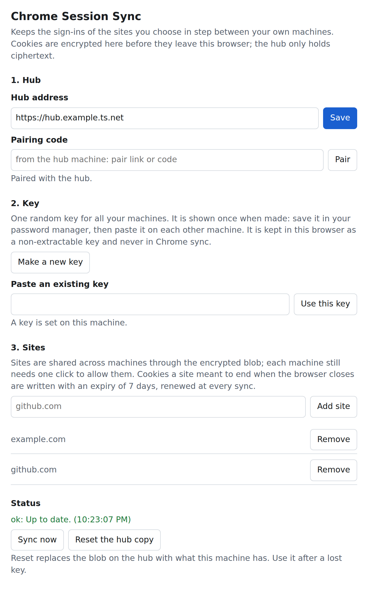
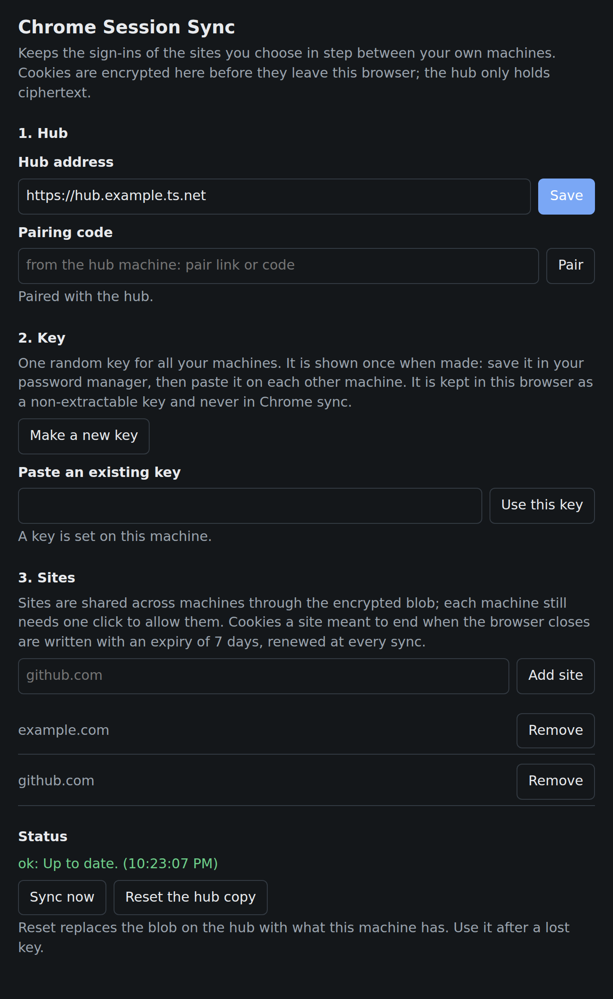
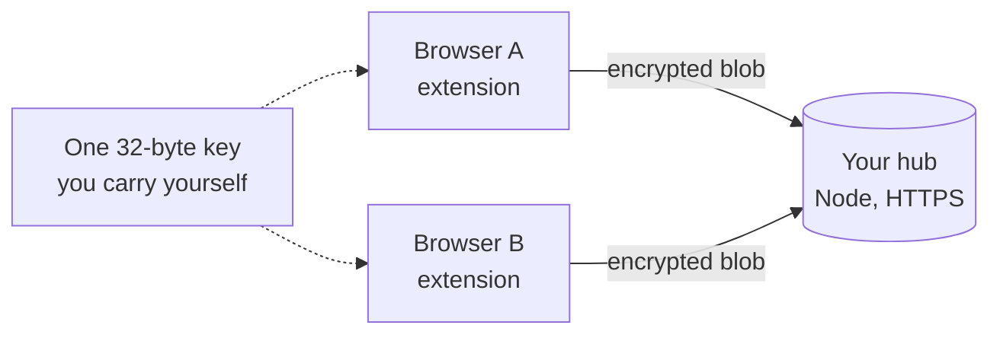

<p align="center">
  
</p>

<h1 align="center">Chrome Session Sync</h1>

<p align="center">
  Your sign-ins, on all your machines, without handing them to anyone.
</p>

<p align="center">
  <a href="https://github.com/MehdiMamas/chrome-session-sync/actions/workflows/ci.yml"></a>
  <a href="LICENSE"></a>
</p>

<p align="center">
  <a href="docs/media/launch.mp4"></a>
</p>

<p align="center">
  
  
</p>

Chrome Session Sync keeps the sign-in cookies of sites you choose in step between your own machines. Sign in once on one machine and the others are signed in too. The cookies are encrypted in the browser before they leave it, and the only server involved is a small one you run yourself.

## Why it exists

Browser sync either does not carry cookies, so you sign in again on every machine, or it sends them to a vendor's servers. This project does neither: cookies travel, and only as ciphertext to a hub you host. The hub never has the key.

## What you get

- Pick the sites to sync. Only their cookies travel; everything else stays where it is.
- Normal, Secure and HttpOnly cookies arrive with their attributes intact.
- Session cookies, which a browser would drop on close, are kept alive with a 7-day expiry that is renewed at every sync.
- A newer cookie wins. A machine that has just joined never overwrites a sign-in with its stale copy.
- A hub with no dependencies: one Node file, one encrypted blob on disk.

## How it works



1. The extension watches the cookies of the sites you added.
2. It merges them with the hub's copy, encrypts the result with AES-256-GCM and uploads it. Every 5 minutes, and after changes, it also pulls.
3. The hub stores one blob and a revision number. A write must name the revision it replaces, so two machines cannot silently overwrite each other.

More detail is in [docs/ARCHITECTURE.md](docs/ARCHITECTURE.md).

## Security model

What the hub can see: the size of the blob, its revision, when it is read or written, and the IP address of whoever connects. It stores only a hash of each device's token.

What the hub cannot see: which sites you sync, any cookie name or value, or your key.

How it is protected:

- One random 32-byte key, made in the extension and carried by you between machines. HKDF derives an AES-GCM key and a key-check key from it. They are non-extractable `CryptoKey` objects in IndexedDB. They are never in Chrome sync and never sent to the hub.
- Each machine pairs with a one-time code that is valid for 10 minutes and gets its own bearer token.
- The hub accepts writes and pairing only from the extension's pinned Origin.
- A machine refuses a blob older than one it has seen, and never overwrites a blob it cannot decrypt.

## Limits

Cookies are not the whole of a sign-in. Be clear about what will not work:

- Sessions bound to a device do not travel. Google's Device Bound Session Credentials and Cloudflare's `cf_clearance` are tied to the browser that got them.
- Sites that keep the sign-in in `localStorage` or IndexedDB instead of cookies are not covered.
- Anyone who holds your key and a paired device can read the blob. Treat the key like a password.
- A site may sign you out when it sees the same session from a new IP address or browser. That is the site's choice.
- Keep banking and your primary email out of the list. A stolen session there costs the most.

## Install

You need Chrome, and a machine that can run Node.js 22 and stay on, for the hub.

### 1. Run the hub

```bash
git clone https://github.com/MehdiMamas/chrome-session-sync.git
cd chrome-session-sync
node server/standalone.mjs --dir ~/.local/share/chrome-session-sync
```

It listens on 127.0.0.1:8787. Put it behind HTTPS: the extension talks to the hub only over https. [Tailscale Serve](https://tailscale.com/kb/1242/tailscale-serve) is an easy way, for example `tailscale serve --bg --https=8445 http://127.0.0.1:8787`, which gives you an address like `https://hub.example.ts.net:8445` that only your own devices can reach.

On Linux you can run the hub as a systemd user service so it starts with your session: see [docs/systemd.md](docs/systemd.md).

Or run the hub as a container. The image keeps its state in `/data`, so mount a volume there:

```bash
docker build -t chrome-session-sync .
docker run -d --name chrome-session-sync \
  -p 127.0.0.1:8787:8787 \
  -v chrome-session-sync-data:/data \
  chrome-session-sync
docker exec chrome-session-sync node server/standalone.mjs --dir /data --pair
```

The pairing command prints the one-time code as usual. From the first tagged release on, the image is also published to GHCR as
`ghcr.io/mehdimamas/chrome-session-sync:<tag>`.

### 2. Load the extension

1. Open `chrome://extensions` and turn on Developer mode.
2. Click Load unpacked and choose the `extension/` folder of your clone.
3. Do this on every machine. Branded Chrome has no other way to load it yet.

Once a release has been published you do not need a clone for this step: download `chrome-session-sync-<tag>.zip` and its `.sha256` file from [Releases](https://github.com/MehdiMamas/chrome-session-sync/releases), check the download with `sha256sum -c chrome-session-sync-<tag>.zip.sha256`, unzip it, and choose the unzipped folder in step 2.

### 3. Pair and choose sites

1. On the hub machine run `node server/standalone.mjs --dir ~/.local/share/chrome-session-sync --pair`. It prints a one-time code.
2. Open the extension's options page. Enter the hub address and click Save, allow the permission Chrome asks for, then paste the code and click Pair.
3. On the first machine click Make a new key and save it in your password manager. On the others paste that key and click Use this key.
4. Add a site such as `github.com` and allow the permission. Each machine needs one click per site.
5. Click Sync now. The status line should read `ok`.

## Roadmap

- Giver and receiver roles per device, so a machine can only send or only receive. ([#1](https://github.com/MehdiMamas/chrome-session-sync/issues/1))
- Several saved logins per site with one-click switching, like a password manager for cookies. ([#2](https://github.com/MehdiMamas/chrome-session-sync/issues/2))
- Signed release zips, so you do not need to clone the repo to load the extension. ([#3](https://github.com/MehdiMamas/chrome-session-sync/issues/3))
- A container image for the hub. ([#4](https://github.com/MehdiMamas/chrome-session-sync/issues/4))

## Contributing

Issues labelled [good first issue](https://github.com/MehdiMamas/chrome-session-sync/labels/good%20first%20issue) are small and self-contained. See [CONTRIBUTING.md](CONTRIBUTING.md). Report security problems as described in [SECURITY.md](SECURITY.md). This project follows the [Code of Conduct](CODE_OF_CONDUCT.md).

## License

GPL-3.0, see [LICENSE](LICENSE).

The launch video uses "Business Moves" by Sascha Ende ([ende.app](https://ende.app)), licensed CC BY 4.0.
